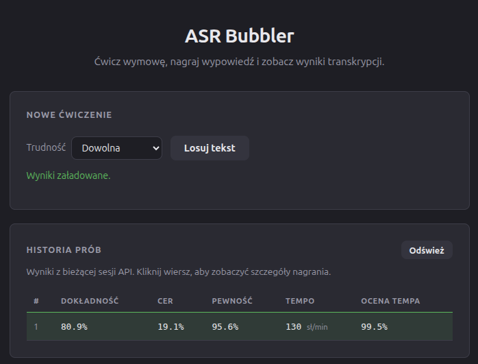
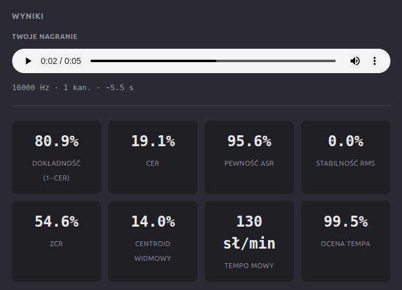
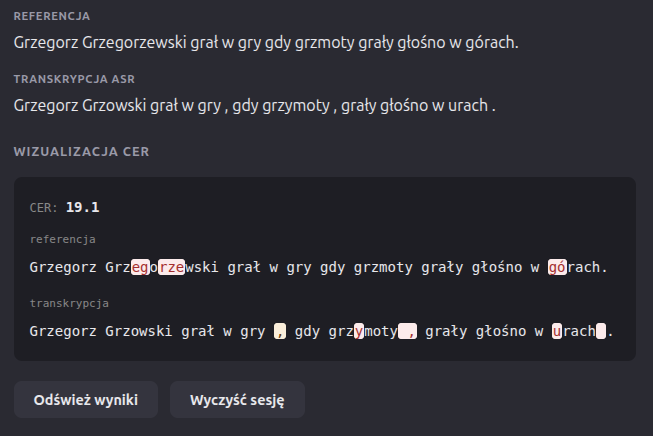

# ASR Bubbler

Polish diction practice app: read a tongue-twister, record your voice, get ASR transcription and pronunciation metrics.

## How to run

From the repo root ([uv](https://docs.astral.sh/uv/) recommended):

**1. API** (port 8000)

```bash
uv run uvicorn API.main:app --host 127.0.0.1 --port 8000
```

**2. Frontend** (port 8080, proxies API)

```bash
uv run python frontend/serve.py
```

Open **http://127.0.0.1:8080**

API docs: **http://127.0.0.1:8000/docs**

> Scores and history live in memory until the API restarts.

## Screenshots

| Main UI | Scores (last attempt) | CER visualization |
|---|---|---|
|  |  |  |

- **Main UI** — draw a random tongue-twister and review previous attempts.
- **Scores** — metrics from the most recent attempt.
- **CER visualization** — highlights mismatches between reference and transcription.

## Metrics

| Metric | Meaning |
|--------|---------|
| **CER** | Character Error Rate vs reference text (lower is better) |
| **Accuracy (1−CER)** | Match between reference and ASR output |
| **ASR confidence** | Model confidence on the transcription |
| **RMS stability** | Loudness consistency over time |
| **ZCR** | Zero-crossing rate (noisiness / articulation) |
| **Spectral centroid** | Brightness of the voice spectrum |
| **Speaking rate** | Words per minute (from word timestamps) |
| **Speaking rate score** | How close tempo is to ~130 WPM |

CER visualization highlights mismatches between reference and transcription.

## Stack

- **Backend:** Python 3.11+, FastAPI, Uvicorn, librosa, jiwer, [NeMo](https://github.com/NVIDIA/NeMo) (`nvidia/stt_pl_fastconformer_hybrid_large_pc`)
- **Frontend:** HTML, CSS, vanilla JavaScript (mic → 16 kHz WAV → API)
- **Notebook:** Jupyter (`Notebooks/Scoring_Pipeline.ipynb`) for experiments

More frontend details: [frontend/README.md](frontend/README.md).
